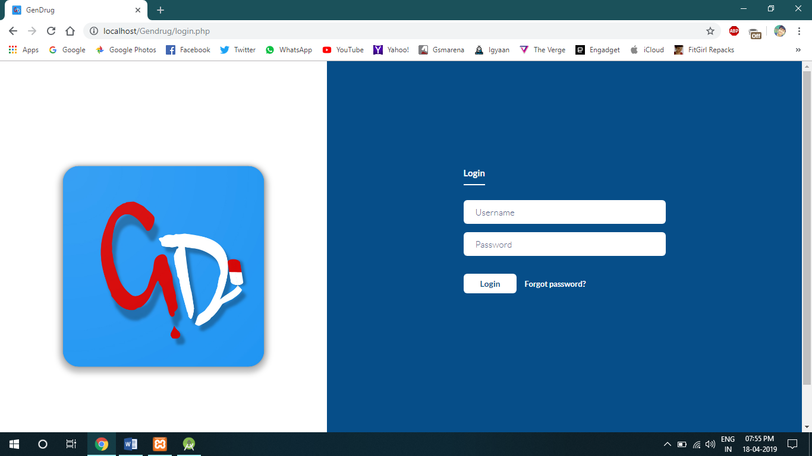
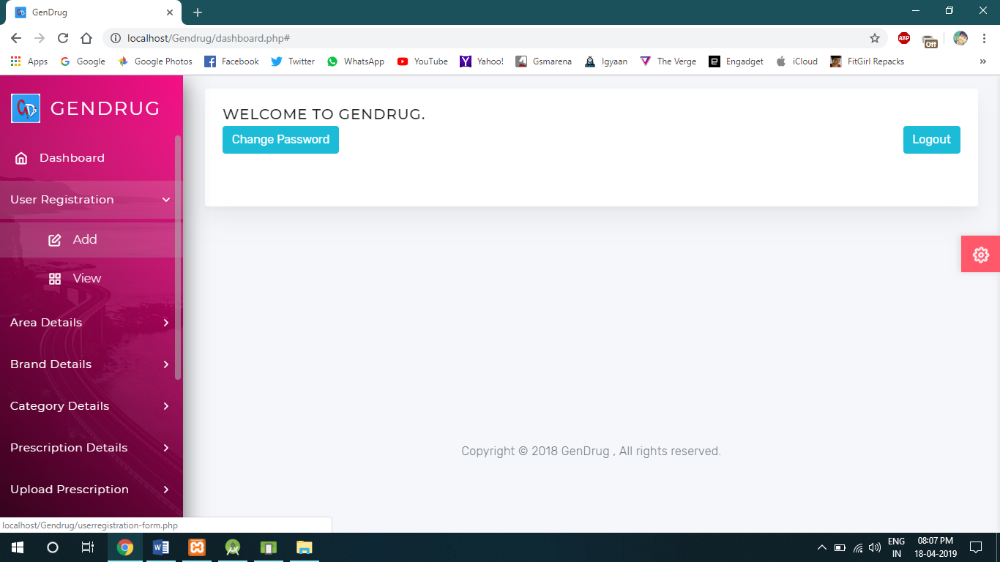
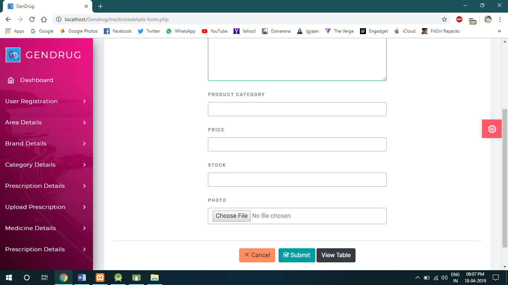
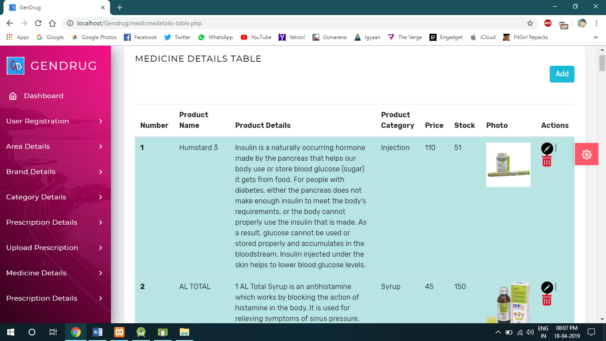

# GenDrug — PHP Admin Panel & REST API

Web admin dashboard and JSON REST API backend for the [Gendrug Android App](https://github.com/vrajesh007/Gendrug-Android-App) (generic medicine search, prescription lookup, cart, and order management).

---

## Screenshots

<p align="center">
  
  
  <br />
  
  
</p>

---

## Quick Start (Docker Compose)

1. Build and start Apache/PHP + MySQL 8 (automatically imports `database/gendrug.sql`):

```bash
docker compose up --build
```

2. Open **http://localhost:8080/Login.php** in your browser.
3. The REST endpoints (e.g. `medicinedetails-displayapi.php`, `cart-view-api.php`, `order-listing-api.php`) are served at `http://localhost:8080/` and are preconfigured to work with the [Gendrug Android App](https://github.com/vrajesh007/Gendrug-Android-App) (`10.0.2.2:8080` from the Android Emulator).

---

## Environment Variables

Copy `.env.example` to `.env` if you want to customize database or SMTP password-reset settings:

- `DB_HOST`, `DB_USER`, `DB_PASS`, `DB_NAME` — MySQL connection settings
- `APP_BASE_URL` — Base URL used for upload paths
- `SMTP_HOST`, `SMTP_USER`, `SMTP_PASS`, `SMTP_FROM` — Optional PHPMailer SMTP settings for `Forgotpassword.php` / `forgotpassword-api.php`

---

## Repository Structure

```text
├── *.php                  # Admin CRUD pages & mobile JSON REST APIs
├── class/atclass.php      # Database & upload configuration
├── database/gendrug.sql   # Full MySQL schema and seed data
├── docs/screenshots/      # Admin panel UI screenshots
├── Dockerfile
├── docker-compose.yml
├── composer.json          # PHPMailer dependency
└── .env.example
```
